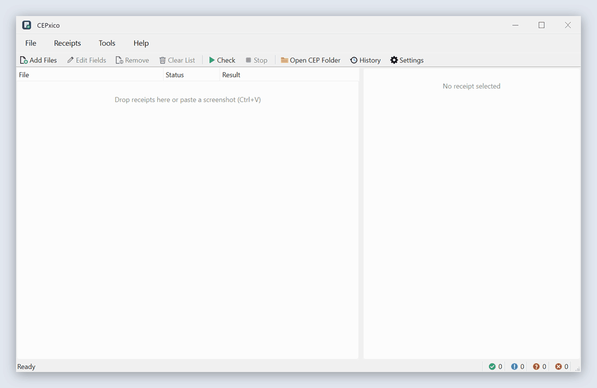

<div align="center">


# CEPxico

Checks SPEI transfer receipts against Banxico.

[Download](https://github.com/SulkBash/CEPxico/releases/latest) · [Guide](docs/GUIDE.md) · [Contributing](CONTRIBUTING.md)

</div>

<p align="center">
  
</p>

CEPxico takes a SPEI receipt (a PDF, a screenshot or a photo), reads the transfer data
from it and looks the transfer up in Banxico's [CEP service](https://www.banxico.org.mx/cep/).
If Banxico finds it, the transfer went through, and CEPxico saves the CEP (Comprobante
Electrónico de Pago) that Banxico issues for it.

## Features

- Reads PDFs, screenshots, phone photos and pasted images. OCR runs on your computer.
- Identifies the sending and receiving banks using Banxico's bank catalog for the
  payment date.
- Saves the CEP as a PDF, an XML file or both, and compares it with the receipt (clave de
  rastreo, amount and account).
- Flags a transfer that was already confirmed for a different receipt file.
- Checks several receipts at once (4 by default).
- Desktop app and command line, in Spanish or English, for Windows, macOS and Linux.

Each receipt gets one of four results: Confirmed, Review, Not Found or Error. The
[guide](docs/GUIDE.md#results) explains each one.

### Editing fields

If a field can't be read, or the receipt doesn't show it (some banks hide most of the
account number), you can type it in Edit Fields and check the receipt again.

<p align="center">
  
</p>

## Install

Download the file for your system from the
[latest release](https://github.com/SulkBash/CEPxico/releases/latest) and unzip it. Python
isn't needed. Open `cepxico-gui`, or `CEPxico.app` on a Mac.

| System | File |
|---|---|
| Windows 10/11 (64-bit) | `CEPxico-<version>-windows-x64.zip` |
| macOS (Apple silicon) | `CEPxico-<version>-macos-arm64.zip` |
| Linux (x64, glibc 2.35+) | `CEPxico-<version>-linux-x64.tar.gz` |

The builds aren't code-signed, so Windows and macOS warn the first time you open them. On
Windows, click **More info**, then **Run anyway**. On macOS, try to open the app once, then
go to **System Settings → Privacy & Security** and click **Open Anyway**.

<details>
<summary>Install from source (Python 3.11+)</summary>

```bash
git clone https://github.com/SulkBash/CEPxico.git && cd CEPxico
python -m venv .venv
source .venv/bin/activate        # Windows: .venv\Scripts\activate
pip install -e .
```

- On Linux, Qt also needs `libxcb-cursor0` (`sudo apt install libxcb-cursor0`).
- With Anaconda's Python on Windows, PySide6 6.10 and later fail with "DLL load failed".
  Install `pip install "PySide6-Essentials<6.10"` instead.

</details>

## Use

In the desktop app, drop receipts on the window (or paste a screenshot) and click
**Check**. CEPs are saved to `~/Downloads/CEPs/`.

From the command line:

```bash
cepxico receipt1.pdf receipt2.png     # exit code 0 only if every CEP was found
cepxico D:\Receipts --csv results.csv # every receipt in a folder, results also saved as CSV
```

The [guide](docs/GUIDE.md) covers settings, history, keyboard shortcuts, dollar transfers
(SPID) and all command-line options.

## Privacy

CEPxico only connects to Banxico's CEP service (`banxico.org.mx`), and only to check
receipts you add. For each receipt it sends the fields Banxico's web form asks for: date,
clave de rastreo, sending and receiving bank, account and amount, plus the security code
you type for dollar transfers. It also downloads Banxico's bank list for the payment date.
There is no telemetry and no update check.

Receipts, settings, the [history](docs/GUIDE.md#history), the log and saved CEPs stay on
your computer. The log shortens account numbers and claves de rastreo to their last 4
characters.

## Contributing

Bug reports and pull requests are welcome. [CONTRIBUTING.md](CONTRIBUTING.md) covers
setup, an overview of the code and how to add support for a bank's receipts. Don't attach
real receipts or CEPs to issues; they contain account numbers.

## License

[AGPL-3.0-or-later](LICENSE). If you distribute a modified version, or run one as a
service for other people, you must publish its source under the same license. Using
CEPxico to check your own receipts has no such requirement. PyMuPDF, which CEPxico uses
to read PDFs, is also AGPL-3.0.

<sub>CEPxico is not affiliated with Banco de México.</sub>
