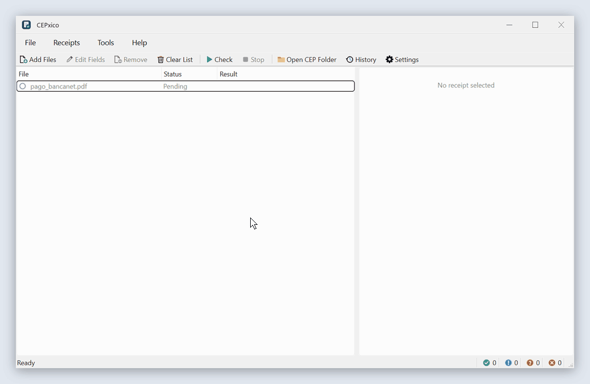

<div align="center">


# CEPxico

**Is that SPEI transfer real? Drop in the receipt and let Banxico answer.**

[](https://github.com/SulkBash/CEPxico/actions/workflows/tests.yml)
[](https://github.com/SulkBash/CEPxico/releases/latest)


[](LICENSE)

[**Download**](https://github.com/SulkBash/CEPxico/releases/latest) · [Guide](docs/GUIDE.md) · [Contributing](CONTRIBUTING.md)

</div>

<p align="center">
  
  <br><sub>Sample receipts with invented data.</sub>
</p>

Screenshots of transfers are easy to fake. CEPxico reads the receipt you were sent (PDF,
screenshot or phone photo), pulls out the transfer data and asks Banxico's
[CEP service](https://www.banxico.org.mx/cep/) for the official *Comprobante Electrónico de
Pago*. If Banxico has it, the money really moved, and you keep the signed CEP as proof.

## Features

- 📄 **Any receipt.** PDFs, screenshots, phone photos taken at an angle, pasted images.
  OCR is built in and works offline.
- 🏦 **Every bank.** Banks are identified from Banxico's own catalog for the payment date,
  so renames and new banks just work.
- ✅ **Proof, not guesses.** Downloads the CEP (PDF, signed XML, or both) and compares it
  with the receipt: clave de rastreo, amount and account.
- 🔁 **Catches reused receipts.** A real receipt forwarded twice, or last week's sent
  again, is flagged instead of passing.
- ⚡ **Batches.** Drop a whole folder; receipts are checked 4 at a time.
- 🖥️ **Desktop app and command line**, in Spanish or English.
- 🔒 **Private.** Runs on your computer and talks only to Banxico. Nothing is uploaded
  anywhere else.

Every receipt ends up **Confirmed**, **Review** (real, but something's off: paid to
another account, already used…), **Not Found** (Banxico has no such transfer: likely
fake) or **Error** (couldn't check). [What each one means →](docs/GUIDE.md#results)

### Fill in what the receipt hides

Some banks print the account as `***756`. Double-click the receipt, type what's missing,
and check again.

<p align="center">
  
</p>

## Install

**Download the app** from the [latest release](https://github.com/SulkBash/CEPxico/releases/latest).
No Python needed: unzip it and open `cepxico-gui` (`CEPxico.app` on a Mac).

| System | File |
|---|---|
| Windows 10/11 (64-bit) | `CEPxico-<version>-windows-x64.zip` |
| macOS (Apple silicon) | `CEPxico-<version>-macos-arm64.zip` |
| Linux (x64, glibc 2.35+) | `CEPxico-<version>-linux-x64.tar.gz` |

The app isn't code-signed yet. On Windows, click **More info → Run anyway** the first
time; on macOS, right-click the app and choose **Open**.

<details>
<summary><b>Or install from source</b> (Python 3.11+)</summary>

```bash
git clone https://github.com/SulkBash/CEPxico.git && cd CEPxico
python -m venv .venv
source .venv/bin/activate        # Windows: .venv\Scripts\activate
pip install -e .
```

- **Linux:** Qt also needs `libxcb-cursor0` (`sudo apt install libxcb-cursor0`).
- **Windows with Anaconda's Python:** PySide6 6.10+ fails with "DLL load failed"; use
  `pip install "PySide6-Essentials<6.10"`.

</details>

## Use

**Desktop app:** open `cepxico-gui`, drop receipts on the window (or paste a screenshot)
and press **Check**. CEPs are saved to `~/Downloads/CEPs/`.

**Command line:**

```bash
cepxico receipt1.pdf receipt2.png     # exit code 0 only if every CEP was found
cepxico D:\Receipts --csv results.csv # a whole folder, with a CSV of the results
```

Settings, history, keyboard shortcuts, dollar transfers (SPID) and every CLI option are
in the [guide](docs/GUIDE.md).

## Contributing

Bug reports and pull requests are welcome; [CONTRIBUTING.md](CONTRIBUTING.md) explains
the setup, how the code fits together and how to teach CEPxico a new bank's receipts.
Please never attach real receipts or CEPs: they contain account numbers.

## License

[AGPL-3.0-or-later](LICENSE). Anyone may use, study, change and share CEPxico, including
commercially. Whoever shares a changed version, or offers one to others over a network (a
website, an API, a bot), must make its source available under the same license. Using
the app to check your own receipts carries no obligation. PyMuPDF, which reads the PDFs,
is itself AGPL-3.0, so the built app is AGPL as a whole either way.

<sub>CEPxico is an independent project, not affiliated with or endorsed by Banco de
México. It uses Banxico's public CEP service the same way its web page does.</sub>
